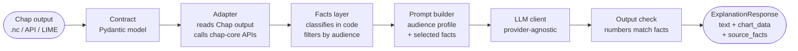
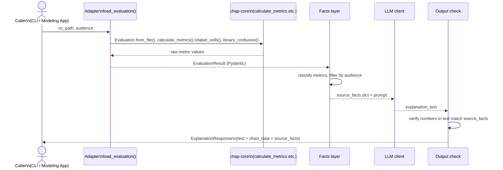

# ARCHITECTURE.md

LLM-based building blocks that explain Chap ML results to different audiences.

## Pipeline

```
Chap output → contract → adapter → facts layer → prompt → LLM → output check → eval harness
```



| Layer | Responsibility | Must NOT |
|---|---|---|
| Adapter | Read Chap output, call Chap's own code, fill the contract | Interpret results, call an LLM |
| Contract | Pydantic models: the only format the rest of the system knows | Contain prose |
| Facts layer | Turn numbers into facts in code ("underestimates", "too few outbreaks to judge") | Call an LLM |
| Prompt | Audience profile + template + selected facts | Compute anything |
| LLM client | Provider-agnostic call, structured JSON output | Be tied to one vendor |
| Output check | Verify numbers and alert status in the text match the input; fallback | |
| Eval harness | Deterministic checks → LLM-as-judge with rubric → human calibration | |

## Principles

1. **Code computes, the LLM phrases.** The LLM only receives finished facts.
2. **One contract, audience as a parameter.** Adaptation happens in the facts layer and prompt, not in separate contracts.
3. **One adapter per data source**, with one function per result type and shared helpers.
4. **Reuse chap-core.** Metrics, thresholds and scoring come from Chap's own functions.
5. **Build one vertical slice first** (evaluation end to end) before adding alerts and XAI.
6. **Honesty about uncertainty**, including uncertainty in the threshold itself.
7. **chap_llm returns JSON, frontend renders.** No PNG or HTML generated here.

## Audiences

Audience is a parameter passed by the caller — never inferred automatically.

| Value | Reader | Focus |
|---|---|---|
| `epidemiologist` | Technical — understands CRPS, sensitivity, baselines | Full metric detail, caveats, methodology |
| `district_health_manager` | Operational — acts on alerts | Whether the model can be trusted for decisions, what alerts mean |
| `decision_maker` | Strategic — allocates resources | High-level reliability, what the system does and doesn't know |

The facts layer filters which facts are included per audience. The prompt template sets tone and detail level.

## Response contract

Every LLM endpoint returns an `ExplanationResponse`:

```python
class ExplanationResponse(BaseModel):
    audience: Literal["epidemiologist", "district_health_manager", "decision_maker"]
    result_type: Literal["evaluation", "xai", "alarm"]
    explanation_text: str          # natural language, written by the LLM
    chart_data: dict | None        # structured JSON for the frontend to render
    source_facts: dict             # the facts dict passed to the LLM — for audit and output check
```

`source_facts` is the structured dict the facts layer produced and the prompt injected. It is returned alongside the text so the output check can verify that numbers in `explanation_text` match `source_facts`. It is also useful for debugging prompts.

## Sequence: evaluation explanation request



## Adapter

```
chap_llm/adapter/
    evaluation.py    load_evaluation(nc_path) → EvaluationResult    ✅ done
    alarm.py         load_alarm(...)           → AlarmResult         (after evaluation slice)
    xai.py           load_xai(...)             → XAIResult           (after inspecting LIME output)
```

Both a CLI adapter (reads `.nc` files) and an API adapter (reads live `AlertPolicy` from chap-core REST API) share the same contracts. API adapter is deferred until the CLI slice works end to end.

`load_evaluation()` steps: open and validate the `.nc` file → `calculate_metrics()` (global, per location, per horizon) → thresholds and alerts via `label_cells()` / `score()` with an in-memory `AlertLevel` → metadata → contract.

Chap imports used:
```python
from chap_core.assessment.evaluation import Evaluation
from chap_core.assessment.metrics import available_metrics, calculate_metrics
from chap_core.assessment.outbreak_metrics.scoring import label_cells, score, binary_confusion
from chap_core.database.alert_tables import AlertLevel
from chap_core.assessment.thresholds.params import PercentileParams
from chap_core.assessment.thresholds.percentile import filter_to_baseline
```

## How Chap defines things (verified in chap-core v2.7.0.dev0)

- `.nc` contents: `forecast` [location × time_period × horizon_distance × sample], `observed` [location × time_period], `historical_observed`
- **Outbreak** = observed cases > threshold. Threshold: 75th percentile of same month over baseline window (default).
- **Exceeds** = share of forecast samples above the threshold (a probability).
- **Alert** = exceeds ≥ `exceedance_threshold` (0.5 default).
- **Short baseline:** `filter_to_baseline()` uses whatever years are available; silently truncates.
- **`ratio_above_truth`** = share of samples above the observed value. 0.5 = unbiased.
- **`crps_norm`** = CRPS / (max − min) of all observed values in the dataset. Not comparable per location.
- `metrics.csv` from `chap export-metrics` aggregates all locations and horizons; not used by the adapter.

## Decisions

| Decision | Reason |
|---|---|
| Build against chap-core v2.7.0.dev0 (editable install) | Code read = code run |
| Do not use `outbreak_detection.py` (mean + 2×std) | Removed from dev; current Chap uses `AlertPolicy` |
| Alerts use `local_default` policy (percentile 75, baseline 5 years, exceedance 0.5) | No DB/API yet; recorded explicitly in the contract via `AlertPolicyInfo.source` |
| Adapter reads `.nc`, not `metrics.csv` | The CSV loses per-location and per-horizon detail |
| Contract includes `n_outbreaks`, `n_alerts`, `n_evaluated` | Rates on few events are misleading without counts |
| `baseline_years_used` computed from actual data, not header | Header `historical_context_periods` overstates the data available |
| XAI contract designed only after inspecting LIME output | Avoid designing for an unseen format |
| Provider-agnostic LLM client | Chap runs locally in countries; data sovereignty and cost |
| `source_facts` returned in every response | Enables output check and prompt debugging without re-running |
| chap_llm returns JSON, frontend renders | Separation of concerns; Modeling App uses Highcharts |
| Local LLM or Claude API with anonymized data only | Data sovereignty — no raw case data or identifiable locations to external API |

## Known limitations

- Laos example data has only ~3 years of history; thresholds are unstable.
- `specificity` can be `None` (no non-outbreak periods in test window). Never explain as "no false alarms".
- `crps_norm` is not comparable between locations in the same dataset.
- Backtests explain past performance; real alerts come from `chap predict` or the API.
- Threshold strategy changes conclusions significantly — explanations must always state the strategy used.

## Open questions

See `QUESTIONS.md` (gitignored, local) for the full list. Key open items:

1. Exact Highcharts JSON schema the Modeling App frontend expects for `chart_data`.
2. REST API or CLI or both as the delivery mechanism for chap_llm.
3. Which fields count as "identifying" for the privacy/anonymization rule?
4. LIME: should chap_llm call `explain_lime()` itself, or consume pre-computed output?

## Status

- [x] chap-core v2.7.0.dev0 installed from clone; example evaluation run
- [x] `load_evaluation()` — global, per-location, per-horizon metrics, alert data, metadata
- [x] Tests: global metrics match `metrics.csv`; per-location averages match global; `specificity=None` case; short-baseline flag
- [ ] Facts layer for evaluation (all three audiences)
- [ ] Prompt templates (all three audiences)
- [ ] Provider-agnostic LLM client
- [ ] `ExplanationResponse` contract + output check
- [ ] Eval harness (deterministic → LLM-as-judge → human calibration)
- [ ] `load_alarm()` + alarm facts + alarm prompt
- [ ] Run `chap explain-lime`, design XAI contract, `load_xai()`
